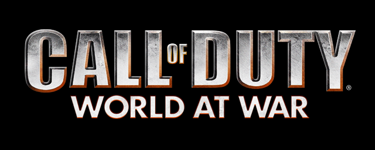
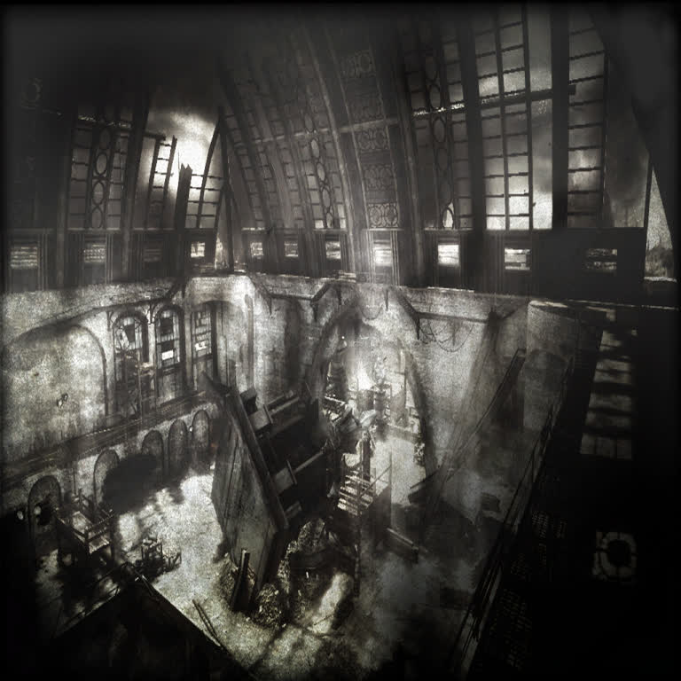
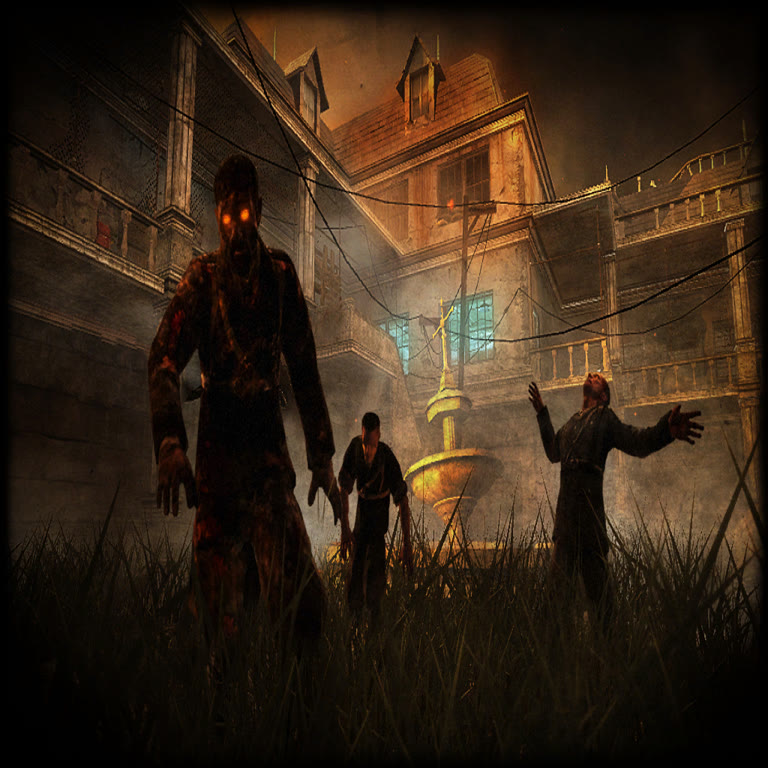
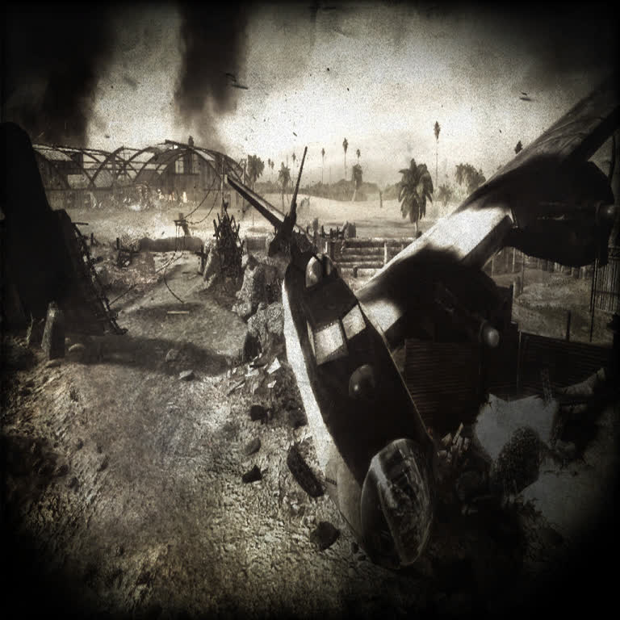

<p align="center">
  
</p>

<h1 align="center">t4port — native port of <i>Call of Duty: World at War</i></h1>

<p align="center">
  <b>Reverse engineering of the game's formats</b> + a <b>100% native C core</b>
  (engine IW 3.0 / Treyarch "T4") + packaging for Linux (<code>.sh</code>,
  Flatpak), Windows (<code>.exe</code>), macOS (<code>.app</code>) and FreeBSD.
</p>

<p align="center">
  <i>Maps shown: <b>mp_dome</b> · <b>zombie_asylum</b> · <b>mp_makin_day</b> ·
  <b>mp_airfield</b> — loadscreens straight from the game data.</i>
</p>

<p align="center">
  
  
  
  
</p>

> **Image credits**: game logo and loadscreens are from *Call of Duty: World at
> War* (**© Activision / Treyarch**) — extracted from a local copy of the game
> and shown here for identification/documentation of this research project
> only. All rights belong to their owners.

---

## 📁 What is in this repository

| Folder | What it is |
|---|---|
| **[`waw port/`](waw%20port/)** | Ready-to-build **deliverable**: full source, prebuilt binaries (Windows `.exe`, FreeBSD), complete docs ([README](waw%20port/README.md)), RE tools |
| **[`port_test/`](port_test/)** | The **development tree**: `src/` (the native engine core), `packaging/` (Flatpak manifest), per-OS build scripts, docs and tools |

Full documentation: **[`waw port/README.md`](waw%20port/README.md)** · project map: [`waw port/PROJECT.md`](waw%20port/PROJECT.md)

## 🚀 Quick start

```bash
# Linux — the launcher starts the GAME (classic retail client)
./t4port.sh                # starts the game (Wine bridge for the retail .exe)

# in-game video options (native, English, detects your APIs)
./t4port.sh menu           # Options > Graphics: VIDEO API / RESOLUTION / FULLSCREEN / VSYNC

# native 3D window — the map's own geometry, no Wine at all
./t4port.sh world mp_dome
```

- **Windows**: double-click `t4port.exe` → it finds `CoDWaW.exe` in the game
  folder and starts it **natively** (no Wine).
- **Flatpak**: the app icon starts the game too (no wine inside the sandbox —
  it delegates to the host launcher via `flatpak-spawn --host`).

## 🧭 Platform status

| Platform | Build | Status |
|---|---|---|
| Linux (`.sh` + Flatpak) | `platforms/linux/build.sh` | ✅ working |
| Windows (`t4port.exe`) | `platforms/windows/build.sh` (zig/mingw) | ✅ cross-built, warning-free |
| FreeBSD | `platforms/freebsd/cross-build.sh` | ✅ cross-built (`ELF ... FreeBSD 14.5`) |
| macOS (`.app`) | `platforms/macos/build.sh` | ⏳ needs a real Mac |

## ⚠️ Status: vibe-coded

This project is **vibe-coded** — written in an AI-assisted, exploratory way —
and **it still presents errors**: expect rough edges, gaps and bugs. Treat it
as a learning/demo artifact around the T4 (IW 3.0) engine, **not** as a
finished product.
