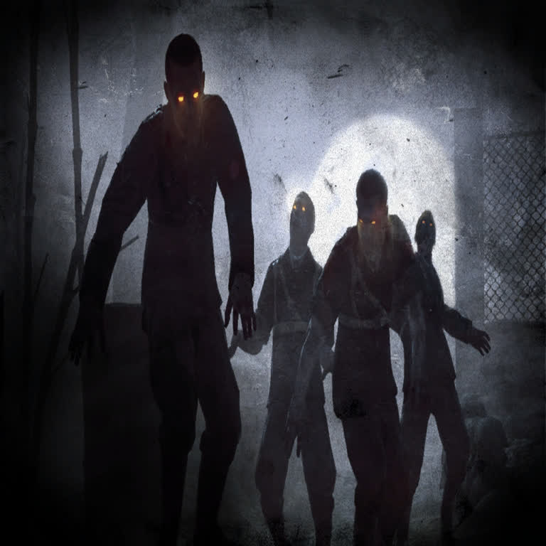
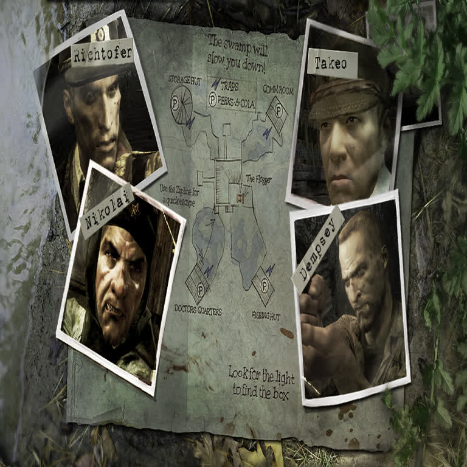
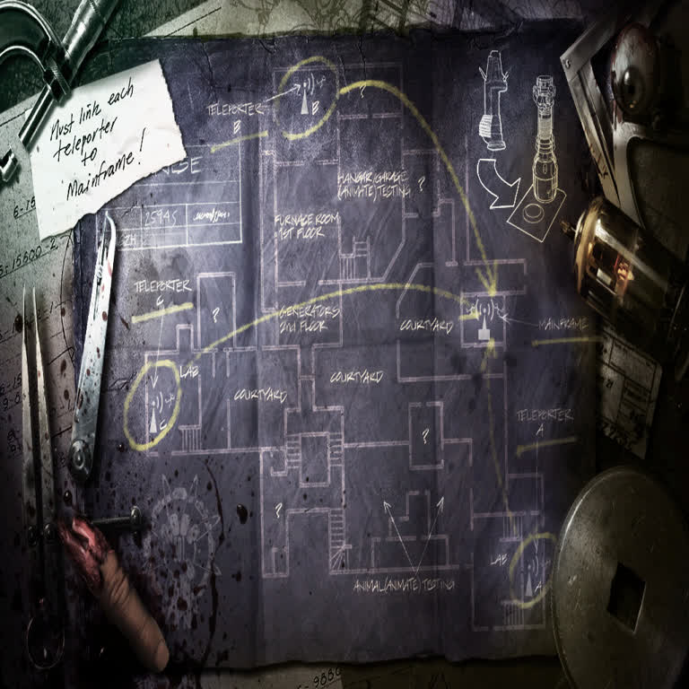
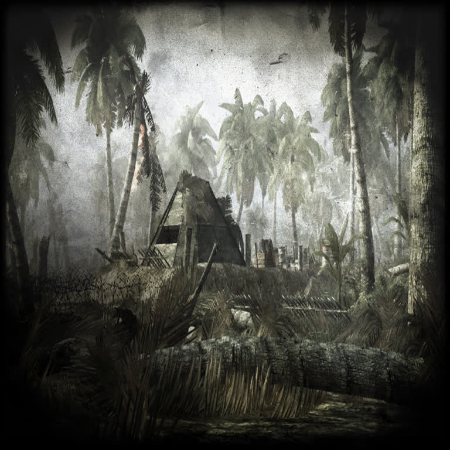
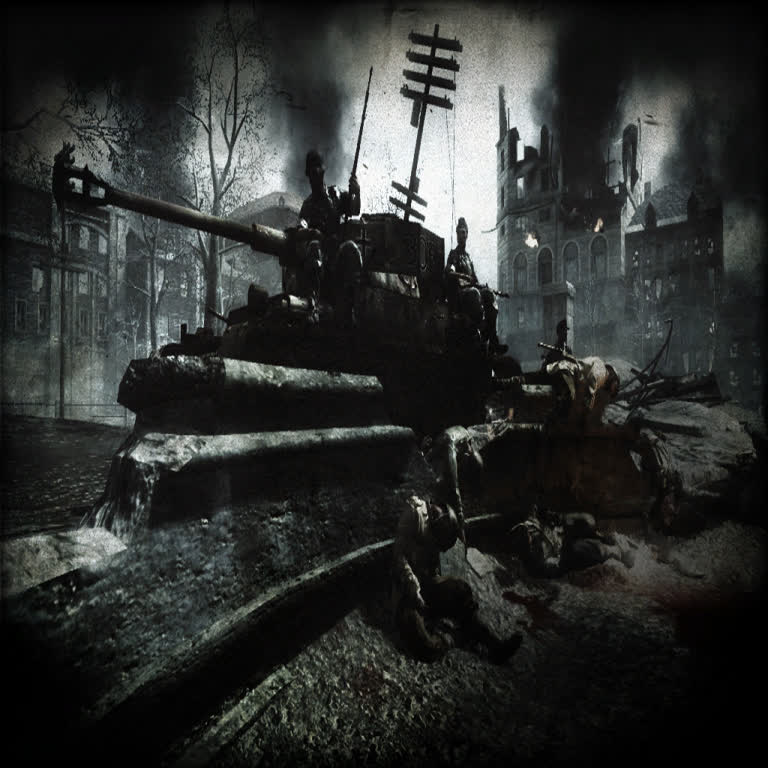
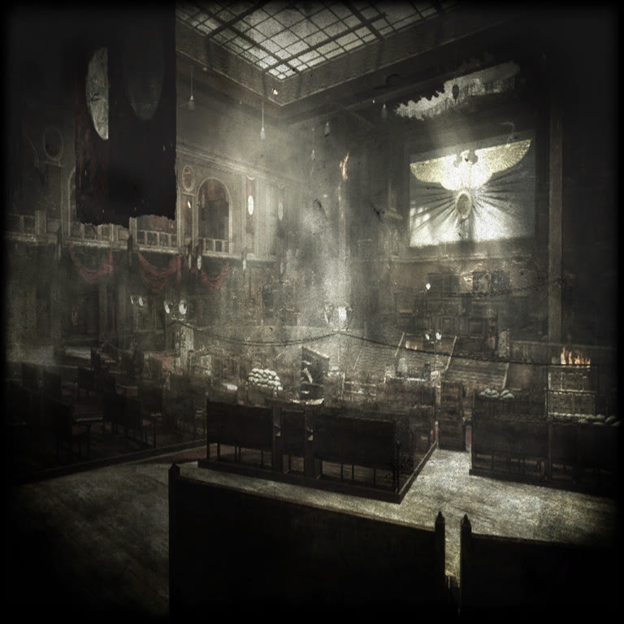
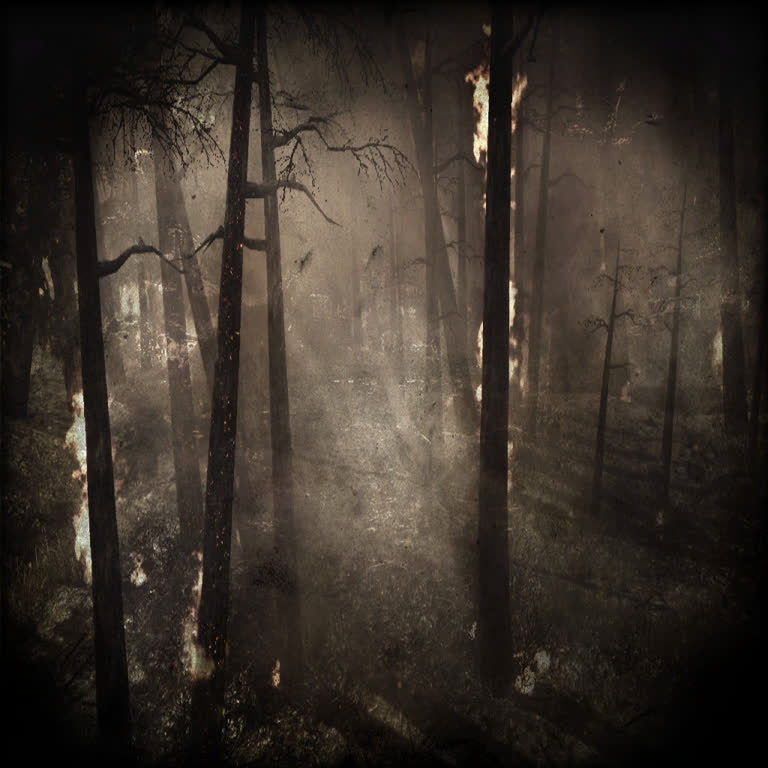
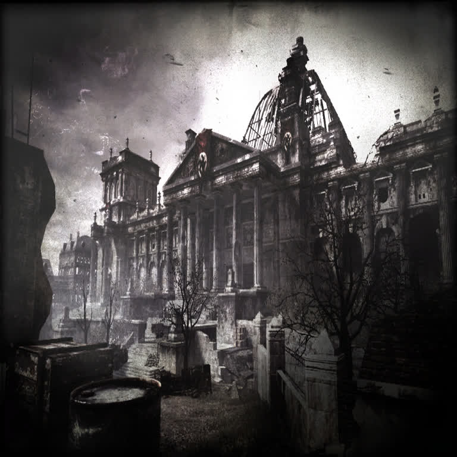
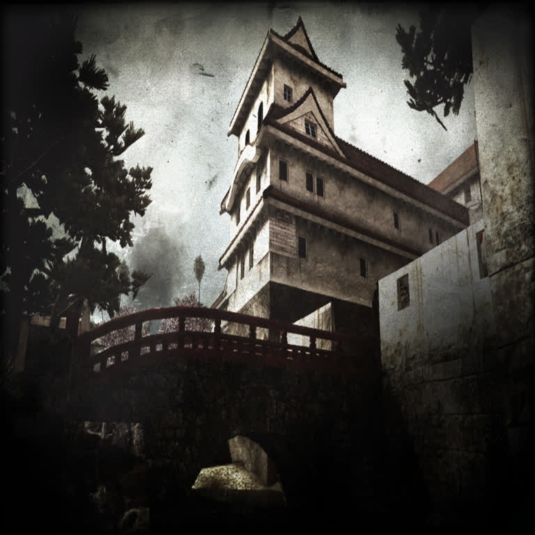
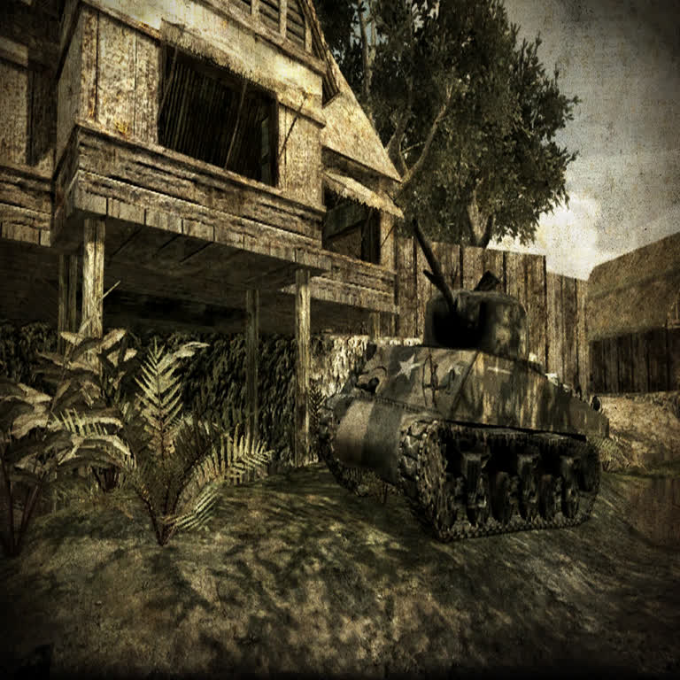

# t4port — native port of *Call of Duty: World at War* (engine **IW 3.0**)

Repository of the **reverse engineering of the game's formats** + **native C
core** + **packaging** for Linux (`.sh`, Flatpak) and macOS (`.app`).

<p align="center">
  
  <br>
  <sub><i>Call of Duty: World at War</i> logo/icon (<code>cod.bmp</code> from
  the game data, © Activision/Treyarch) — used locally in this documentation
  only.</sub>
</p>

> **Target**: *Call of Duty: World at War* (Treyarch, 2008), running on the
> **IW 3.0** engine (Treyarch's variant of Infinity Ward's 3.0). Treyarch's
> internal codename for this game is **"T4"** — hence the name `t4port` and the
> `T4_*` prefixes in the code. (2010's Black Ops is T5; the **387** revision of
> the `.ff` files we analyzed is the WaW one.)

> ⚠️ **Notice**: the game data (`pluto_t4_full_game/`, 8.2 GB) belongs to
> Activision/Treyarch. This project is for local/personal use — do not publish
> the Flatpak with the embedded data anywhere. The port code itself is ours and
> may be distributed.

---

## 1. What has been done (reverse engineering)

### Formats decoded (proven by arithmetic, not by guesswork)

| Format | File | Finding |
|---|---|---|
| **FastFile** | `zone/**/*.ff` | magic `IWffu100` (8 B) + `u32` (=387 in **every** file) + a **single zlib stream** until 11 bytes of padding are missing. The content starts with 3 `u32`s (pool size, data size, asset count). |
| **IWD** | `main/*.iwd` | A plain ZIP (EOCD + central directory) — read directly in C, no libzip. 35 files, 27,017 entries. |
| **IWI** | inside the `.iwd` files | **28-byte** header: `IWi` + version(6) + format + flags + `u16` width + `u16` height + `u16` + `u32[4]` (the first = file size) + mip chain (largest → smallest). **Validated on 100% of the 9,331 textures.** |
| **Bink** | `main/video/*.bik` | Bink Video 1280×720 / 15 fps — decodable with `ffmpeg` (already present). |
| **Launcher** | `plutonium.exe` | Not the game: it is the **.NET 4.8 / WPF updater** (`Plutonium.Updater.App`, Costura/MahApps/Sentry). The engine binary is not in this folder. |

### Texture formats identified (99.1% of the 9,331)

| Code | Format | Files | How it was proven |
|---|---|---|---|
| 1 | BGRA8 (4 B/px) | 48 | 48/48 exact + correct colors on decode |
| 3 | A8L8 (2 B/px) | 46 | mip chain closes exactly + correct look |
| 4 | L8/A8 (1 B/px) | 22 | 22/22 |
| 11 | A8_DXT1 → BC1 (8 B/block) | 2,667 | 2,667/2,667 |
| 12 | A8_DXT5 → BC3 (16 B/block) | 803 | 803/803 + diffuse decoded perfectly |
| 13 | DXN → **BC5**, normal map (16 B/block) | 5,665 | 5,665/5,665 + R channel with mean 129.7 (normal-map statistic) |
| 2, 6–9 | not identified | 80 (0.86%) | *open* |

Decoded samples produced by the tools below:

| BC1/DXT1 load screen (format 11) | BC3/DXT5 compass map (format 12) |
|---|---|
|  |  |

| BC5 normal map (format 13) | A8L8 gradient (format 3) | BC3 cursor (format 12) |
|---|---|---|
|  |  |  |

<sub>Textures from <i>Call of Duty: World at War</i> (© Activision/Treyarch),
decoded by <code>src/iwi.c</code>; local documentation use only.</sub>

Automated survey: `tools/iwi_survey.py`, `tools/iwi_format_probe.py`,
`tools/iwi_decode_probe.py`.

Details in [`doc/RE_SUMMARY.md`](doc/RE_SUMMARY.md) and in
[`re/`](re/) (Python analysis tools).

### Python tools (`re/`)

```bash
python3 re/fftool.py  <file.ff>              # decompresses and lists the assets
python3 re/iwitool.py <file.iwi> -o tex.png  # decodes a texture to PNG
```

### Structured zone walker (C, byte-exact)

`src/zonewalk.c` walks the **whole** zone payload — every XAsset and every
pointer inside it — following the same annotated spec table the validated
Python walker uses (`src/zonetables.inc`, generated by `re/gen_tables.py`).
Validated on `mp_dome.ff` by diffing traces against the Python reference:

- **564/564 asset boundaries identical**, and the walk finishes exactly on
  the last byte of the payload ("walker estruturado: EXATO");
- the `GfxWorld` extracted complete: **321,384 vertices / 653,130 indices
  (217,710 triangles) / 8,724 surfaces**;
- debugging method: `T4_ZW_DEBUG=1` in C (windowable with
  `T4_ZW_FLD_FROM`/`T4_ZW_FLD_TO`) diffed against a monkeypatched
  `_field`/`load_alloc`/`read_string` trace in Python.

Four real bugs were caught and fixed by that diff: the `choisk` count
fallback (`.a`, not the never-written `.nents`), `ptrarr` consuming the
pointer array *after* the pointees instead of before, inverted
`Struct::field` qualified-count resolution, and `choose` comparisons missing
Python's `_s32` signed read (emitted as `C_GE_S` by the generator).

---

## 2. Native core (C11)

```
src/
  iwd.c   ZIP reader (.iwd)                   — EOCD, central directory, deflate
  ff.c    fastfile loader + parser            — inflate, XAssetList, exact walk
  iwi.c   texture decoder                     — BC1/DXT1, BC3/DXT5, BC5/DXN,
                                                 BGRA8, A8L8, L8 -> RGBA8
  mods.c  rawfile extraction + overlay        — mods/<name>/ over the .ff files
  gsc.c   script lexer + parser               — VM phase 1: syntax analysis of
                                                 the 1,391 .gsc/.csc (line/col)
  net.c   LAN layer                           — own T4LAN1/UDP protocol
                                                 (broadcast discovery)
  platform.c per-OS differences               — exe path for Linux/macOS/
                                                 FreeBSD/Windows
  png.c   minimal PNG encoder                 — zlib + crc32 only
  sdl2_dyn.c SDL2 binding                     — dlopen (LoadLibrary on Win)
  zonewalk.c structured zone walker           — byte-exact walk of the whole
                                                  zone payload (ANN specs)
  world.c GfxWorld extraction + render loop   — verts/indices/surfaces, camera
  gfx.c   graphics facade                     — API selection + world/gfx windows
  gfx_gl.c OpenGL backend                     — 4.5/4.3/3.3 core + 2.1 + GLES
  gfx_vk.c Vulkan backend                     — test window (world: next phase)
  gapi.c  GPU/API detection                   — dlopen probes per system
  menu.c  video settings menu                 — SDL2 window, per-API detect
  main.c  CLI                                 — info/zip/ff/iwi/view/extract/
                                                 video/mods/gsc/lan/check/
                                                 world/gfx/menu
```

### Build

```bash
cmake -S . -B build -G Ninja -DCMAKE_BUILD_TYPE=Release
cmake --build build
./build/t4port --check
./build/t4port info ~/Plutonium/pluto_t4_full_game
./build/t4port view --iwd ~/Plutonium/pluto_t4_full_game/main/iw_21.iwd \
      images/loadscreen_mp_makin_day.iwi
```

**SDL2**: `T4PORT_SDL2=auto|linked|dynamic`. Without development headers (the
case on this machine) CMake uses **dlopen** on the runtime `.so`; with
`libsdl2-dev`/Homebrew it links directly. No `*-dev` package is required.

### LAN (local network mode, Ethernet)

```bash
# on the PC that will host (background or another terminal)
./build/t4port lan host --nome "my-server" --mapa nazi_zombie_factory --modo zombies

# on any PC on the network (including the same one)
./build/t4port lan discover            # broadcast on all interfaces + 127.0.0.1
./build/t4port lan discover --to IP    # direct query (tests/firewall)
T4LAN_DEBUG=1 ./build/t4port lan discover   # show the broadcast targets
```

- A **custom** `T4LAN1` protocol over UDP, port **28960** (the CoD server
  convention). QUERY → INFO (name, map, mode, `players/max`, proto).
- Discovery goes through the **directed broadcast of the real interface**
  (e.g. `192.168.100.255`) in addition to `255.255.255.255` → works between
  LAN PCs, not just loopback. The host answers from the IP the query arrived
  on; `Ctrl+C` quits.
- Tested on this machine: local discovery and a unicast query to the Ethernet
  IP (`192.168.100.101`) both answer correctly.
- **Honest limitation**: this is *our* port's protocol. Talking to original WaW
  or Plutonium servers requires the protocol of the engine binary
  (`client_mp_x86.exe`), which is not in this folder — see §10.

### Mods (zombies, campaign, multiplayer)

The game's `.gsc/.csc` scripts live **inside the `.ff` files** as rawfiles; the
parser extracts them exactly and sets up an editable workspace:

```bash
export T4_GAME_DIR=~/Plutonium/pluto_t4_full_game

./build/t4port mods unpack my_mod      # 2,748 files -> mods/my_mod/
./build/t4port mods list               # list the mods
$T4_GAME_DIR/mods/my_mod/maps/_zombiemode_perks.gsc   # edit freely

# where a file would come from (the overlay has priority):
./build/t4port mods which maps/_zombiemode_perks.gsc --mod my_mod
./build/t4port mods which maps/_zombiemode_perks.gsc --search   # -> original .ff

./build/t4port ff <map>.ff -o dir      # extract a single .ff
```

- Resolution order planned for the engine: **`mods/<name>/<path>` → `.ff`**.
- Extracted file names are restricted to ASCII (high bytes were garbage from
  the `.ff` and broke UTF-8 in the Flatpak build — fixed).
- The Flatpak does **not** embed `mods/` (it is user content, generated at
  runtime).
- **GSC syntax analysis is done** (`gsc`, see the next section); what is still
  missing is **VM phase 2** for the game to *run* the edited scripts
  (roadmap §10, item 9).

### GSC (VM — phase 1: syntax analysis)

The **1,391 `.gsc/.csc`** scripts extracted from the `.ff` files are analyzed
end to end by the C lexer/parser (`src/gsc.c`), reporting the first error as
`line:column` plus per-file statistics:

```bash
./build/t4port gsc mods/my_mod/maps/_zombiemode.gsc  # single file
#   lines 2257 | functions 67 | includes 6 | statements 1228 | calls 576

./build/t4port gsc mods/teste_davi                   # directory (recursive)
#   total 1391 | ok 1391 | errors 0
```

Coverage of the scripts' **actual** grammar (everything was surveyed and fixed
against the 1,391 files until it hit `1391/1391`):

- directives `#include`, `#using_animtree( "generic_human" )`, `#define`,
  `include maps\mp\_utility;` **without `#`**, debug blocks `/# ... #/`, and
  the orphan `*/` comment that exists at the end of one real script;
- top-level functions, `if/else`, `for`, `while`, `do..while`,
  `switch/case/default`, `break/continue/return`, `wait <expr>;`;
- calls "injected" into the object (GSC does not use a dot):
  `self waittill( "death" );`, `level thread f();`,
  `if ( other thread friendly_mg42_useable( mg42, node ) )`,
  `self maps\_laststand::player_is_in_laststand()`,
  `endPos = self endnode.origin`;
- function pointers: `[[ level.spawnPlayer ]]()` and
  `array_thread( arr, ::func )`;
- literals: floats (`1.5`, `.8`), hex, `%climbstairs_down`, `#animtree`,
  arrays `[]`, tuples `( 0, 0, 4 )`, `&"AUTOSAVE_LEVELSTART"` (localization),
  single/double-quoted strings;
- identifiers containing `\` (`animscripts\utility::UpdateAnimPose()`), `;`
  omitted before the line break (present in the real game), `//` and `/* */`
  comments.

Validation: **1391/1391 on the regular build, on ASan/UBSan (zero memory
errors) and on `t4port.exe` under Wine** — the same test base runs on all 3
variants.

> Still missing is **phase 2**: AST + interpreter (threads, `wait`,
> `notify`/`endon`, dvar overlays) — that is what makes the game *run* the
> edited scripts.

---

### Graphics API layer (OpenGL / Vulkan / OpenGL ES)

The 3D layer is pluggable: the video settings choose the API available on the
user's system, and `auto` (default) probes in the order
**OpenGL → Vulkan → OpenGL ES**. Every library is loaded at runtime with
`dlopen`, so the same binary runs on any distro/OS without dev packages.

```bash
./build/t4port api                            # config + APIs detected here
./build/t4port api vulkan                     # choose: auto|opengl|vulkan|opengles
./build/t4port gfx                            # test window with the chosen API
./build/t4port gfx --api vulkan --segundos 5  # force API / timed run (tests)
```

#### Native 3D window — the map's own geometry (`world` subcommand)

```bash
./build/t4port world mp_dome             # walks the .ff and opens the window
./build/t4port world mp_dome --walk-only # walk + stats only (no window)
./build/t4port world <map|file.ff> --segundos 5 --shot out.png --wire
```

The window renders the **`GfxWorld` extracted by the structured walker**
above — real map geometry, not a test cube: on `mp_dome.ff` that is
**321,384 vertices / 217,710 triangles / 8,724 surfaces**, positions+normals
with an orbit camera (mouse drag / wheel / WASD, ESC to quit), written to a
GL 4.5/4.3/3.3 core (or 2.1/GLES) context chosen at runtime. Validated here
on **OpenGL 4.5.0 (NVIDIA 470.256.02)** and clean on ASan/UBSan. No Wine, no
emulation: the `.ff` is parsed by the native C walker and the drawing is
native SDL2+OpenGL.

With `r_api=vulkan` in the config the `world` command warns and falls back to
OpenGL (the Vulkan world backend is still the next phase); `--api vulkan`
explicit keeps the honest error.

#### Video settings — Options > Graphics (in-game window, English)

```bash
./build/t4port menu            # opens Options > Graphics (video settings, English)
./build/t4port menu --list     # prints the detection table (works headless)
```

The menu is rendered in software (SDL2 texture — no GPU driver needed to
open it) and is the in-game way to switch APIs:

- **Video API** — cycles only through the APIs **detected on this
  system that have a backend in the port** (`auto` + OpenGL / OpenGL ES /
  Vulkan as available). The choice is saved as `r_api=` and read by every
  other command (`gfx`, `world`, `check`, ...), so it really changes the
  renderer, not just the menu.
- **System detection** — the bottom table shows what `gapi.c` probed:
  loader file for each API (`libGL.so.1`, `libGLESv2.so.2`,
  `libvulkan.so.1`, `opengl32.dll`, `vulkan-1.dll`, `d3d11.dll`,
  `Metal.framework`...) and, on Vulkan, the installed **ICDs** (drivers)
  scanned from `/usr/share/vulkan/icd.d`, `/etc/vulkan/icd.d`,
  `~/.local/share/vulkan/icd.d`. `[x]` = present, `[ ]` = absent.
  Direct3D 11/12 and Metal are shown for completeness but the port has no
  backend for them yet (`backend:no`), so they never appear as choices.
- **Every resolution** — the Resolution row is **dynamically enumerated**:
  every mode each monitor/output announces via SDL (multi-monitor too),
  merged with a wide preset table (640x480 ... 7680x4320) and with the
  `r_mode` value from `t4port.cfg` — even a hand-typed WxH (e.g.
  `3440x1440` ultrawide or `5120x2880`) is listed and applied. Stored as
  `r_mode`, `r_fullscreen`, `r_vsync`; vsync recreates the menu renderer
  on the fly, fullscreen is applied on the next window. `menu --list`
  prints the full enumerated resolution set; the `gfx`/`world` windows
  honor `r_mode` too (`--janela W H` overrides per run). The menu window closes with ESC,
  ENTER or the X button (SDL_QUIT / SIGTERM are handled).

#### NVIDIA support (any card: GT / GTX / RTX / Quadro / Tesla / MX)

```bash
./build/t4port gpu             # report: cards, kernel module, GL, Vulkan, ICD
./build/t4port gpu --fix       # creates the user Vulkan ICD (no root needed)
T4_GPU=nvidia ./build/t4port gfx --api vulkan   # force NVIDIA everywhere
```

- **PCI detection** counts every GPU by vendor (`0x10de` NVIDIA, `0x1002`
  AMD, `0x8086` Intel, class `0x03`) — any model, any generation; the
  driver version is read from `/proc/driver/nvidia/version`.
- **Vulkan**: when the NVIDIA driver is present and really exports
  `vk_icdGetInstanceProcAddr` but no `nvidia_icd*.json` exists (typical
  when only the Mesa ICDs are registered), `gpu --fix` writes
  `~/.local/share/vulkan/icd.d/nvidia_icd.json` pointing at
  `libGLX_nvidia.so.0` — user level, reversible (`--unfix`), and refused
  honestly when the installed driver has no Vulkan at all.
- **Device choice**: the Vulkan backend scores devices
  `T4_GPU vendor > discrete > integrated`, so a discrete NVIDIA/AMD card
  wins over the iGPU on any multi-GPU machine (Optimus included).
- **`T4_GPU=nvidia`** additionally sets `__NV_PRIME_RENDER_OFFLOAD=1` +
  `__GLX_VENDOR_LIBRARY_NAME=nvidia` (PRIME laptops) and pins the loader
  to the NVIDIA ICD via `VK_DRIVER_FILES` / `VK_ICD_FILENAMES`.
- **Nouveau** (open driver) is reported too; on Windows the same checks
  use `nvoglv64.dll` / `nvcuda.dll` (the ICD comes from the registry
  there, so `--fix` is a Linux/BSD operation).
- **Every proprietary driver version**: detection relies on stable
  SONAMEs (`libGLX_nvidia.so.0`, `nvoglv64.dll`), so legacy branches
  (340/390/470) and current releases all work. `gpu` prints the kernel
  module **and** userspace library versions plus the expected capability
  of that range (`<360` none, `360-389` 1.0, `390-469` 1.1,
  `470-524` 1.2, `525+` 1.3) beside the real `vk_icd` probe; if the
  `.so.0` symlink is broken the generated ICD falls back to the absolute
  path of the versioned library, and OpenGL runs even on pre-Vulkan
  drivers through the context fallback chain.
- **Per-OS matrix**: Linux = full (PCI + `/proc` + PRIME + user ICD);
  FreeBSD = `nvidia-driver` port (GL/Vulkan/ICD checks and user ICD
  creation work; the PCI count needs the Linux sysfs); Windows =
  `nvoglv64.dll`/`nvcuda.dll` (ICD from the registry); macOS = no NVIDIA
  driver exists after 10.13 (Apple dropped it in Mojave) — reported
  honestly, the game keeps running on the system OpenGL.

The choice persists as `r_api=` in the config file:

| OS | Config file | Backends |
|---|---|---|
| Linux / FreeBSD | `~/.config/t4port/t4port.cfg` (or `$XDG_CONFIG_HOME/t4port/`) | OpenGL (`libGL.so.1`), Vulkan (`libvulkan.so.1`), GLES |
| macOS | `~/Library/Application Support/t4port/t4port.cfg` | OpenGL (deprecated but works up to 4.1), Vulkan through MoltenVK if installed |
| Windows | `%APPDATA%\t4port\t4port.cfg` | `opengl32.dll`, `vulkan-1.dll` (+ `SDL2.dll` next to the `.exe` for windows) |

- **OpenGL**: context fallback 4.5 core → 4.3 core → 3.3 core → 2.1 compat
  (immediate mode), animating a rotating triangle; **GLES**: 3.x
  (`#version 300 es`).
- **Vulkan**: instance → SDL2 surface → swapchain → render pass with animated
  clear → present (SPIR-V triangle is the renderer's next phase).
- The Vulkan structs are declared by hand with `_Static_assert` on the sizes,
  **verified 1:1 against the official Khronos headers** — that is why the
  build does not depend on `vulkan.h`.
- **Tested on this machine (NVIDIA GT 740)**: OpenGL 4.5.0 (core), OpenGL ES
  3.2 and Vulkan 1.0 each open the window, render and exit clean — all three
  also under ASan/UBSan, and the `.exe` reports the APIs through Wine.
- A frozen snapshot of the source from *before* this layer lives in
  `source_original/` (see its README).

---

## 3. Nazi Zombies (game mode — assets, scripts, mod support)

The co-op survival mode Treyarch shipped with WaW: escalating rounds of zombies
on a closed map, points for kills, doors and areas to unlock, Perks-a-Cola
machines and the Pack-a-Punch upgrade bench. All of it lives in this data
folder, and it is the main target of the mods pipeline (§2).

**The 4 retail maps** (internal names — these are the `.ff`, image and script
names):

| Map (retail) | Internal name | FastFiles in `zone/english/` |
|---|---|---|
| Nacht der Untoten | `nazi_zombie_prototype` | `nazi_zombie_prototype.ff`, `…_load.ff` |
| Verrückt | `nazi_zombie_asylum` | `nazi_zombie_asylum.ff`, `…_load.ff`, `…_patch.ff` (+ `localized_…`) |
| Shi No Numa | `nazi_zombie_sumpf` | `nazi_zombie_sumpf.ff`, `…_load.ff`, `…_patch.ff` (+ `localized_…`) |
| Der Riese | `nazi_zombie_factory` | `nazi_zombie_factory.ff`, `…_load.ff`, `…_patch.ff` (+ `localized_…`) |

14 zombie fastfiles in total, plus the intro cinematics
(`nazi_zombie_*_load.bik` → `t4port video`).

**Load screens** decoded straight from the `.iwd` archives with `t4port iwi`:

<p align="center">
  
  
  
</p>
<p align="center"><sub>
  Left→right: the mode's key art (<code>images/loadscreen_zombie1.iwi</code>),
  “Shi No Numa” (<code>loadscreen_zombie_sumpf.iwi</code>) and “Der Riese”
  (<code>loadscreen_zombie_factory.iwi</code>) — © Activision/Treyarch,
  decoded locally for this documentation only.
</sub></p>

### What the port already does for this mode

- **Scripts extracted**: `t4port mods unpack <mod>` pulls every zombie GSC out
  of the `.ff` rawfiles — **42 extracted scripts** reference the zombiemode
  logic and **100 files** carry "zombie" in their name (maps, weapons, perks,
  spawners, air-support…).
- **Overlay priority proven**: `maps/_zombiemode.gsc` resolves to the mod's
  copy when it exists and falls back to `nazi_zombie_sumpf.ff` otherwise.
- **Every zombie script parses**: they are part of the **1391/1391** validated
  by `t4port gsc` (VM phase 1, §2) — including the injected-call style used all
  over the mode (`self waittill( "death" );`, `level thread f();`).
- **Textures of the mode decode natively**: load screens (BC1), compass maps
  (BC3) and normal maps (BC5) — see §1.
- **Still missing**: VM **phase 2** (AST + interpreter) so the game *runs* the
  edited zombie scripts — roadmap §10, item 9.

---

## 4. Campaign (single-player)

Two intertwined stories: the US Marine Corps in the Pacific (Peleliu, Makin,
Okinawa) and the Red Army's push into Berlin. The whole campaign ships here as
**14 missions** — each one a `<mission>.ff` + `<mission>_load.ff` pair (30
fastfiles counting the shared bits) — and **113 campaign scripts** in `maps/`
already extracted by `mods unpack`:

| Mission (internal name) | Theater / place |
|---|---|
| `pel1`, `pel1a`, `pel1b`, `pel2` | Peleliu (USMC, Pacific) |
| `mak` | Makin Atoll landing |
| `oki2`, `oki3` | Okinawa |
| `pby_fly` | PBY Catalina flight sequence |
| `sniper` | The sniper mission |
| `see1`, `see2` | Seelow Heights (Red Army) |
| `ber1`, `ber2`, `ber3`, `ber3b` | Battle of Berlin / Reichstag |

**Load screens** decoded straight from the archives with `t4port iwi`:

<p align="center">
  
  
  
  
</p>
<p align="center"><sub>
  Left→right: Peleliu (<code>loadscreen_sp_pel1a</code>), the sniper mission
  (<code>loadscreen_sp_sniper</code>), Berlin (<code>loadscreen_sp_ber3b</code>)
  and the Seelow Heights (<code>loadscreen_sp_see1</code>) — ©
  Activision/Treyarch, decoded locally for this documentation only.
</sub></p>

What the port already does for the campaign:

- **Every mission script is editable**: `t4port mods unpack <mod>` pulls the
  113 `maps/ber*.gsc`, `maps/pel*.gsc`, `maps/oki*.gsc`, `maps/see*.gsc`,
  `maps/sniper*.gsc` and `maps/mak*.gsc` out of the `.ff` rawfiles, and the
  overlay priority makes your copy win over the shipped one.
- **All of them parse**: part of the **1391/1391** validated by `t4port gsc`
  (VM phase 1, §2).
- **Cinematics**: `intro_pac.ff` (Pacific intro), `outro.ff`, `credits.ff`
  and the `.bik` videos decode through `t4port video`.
- **Still missing**: VM phase 2 + renderer so the missions actually *run* —
  roadmap §10, items 1-9.

## 5. Multiplayer (23 maps, 9 gamemodes, LAN)

WaW's multiplayer ships as **23 maps** (46 fastfiles: `<map>.ff` +
`<map>_load.ff`) plus its whole logic in script form — all of it extracted by
`mods unpack`:

- **9 gamemodes** live in `maps/mp/gametypes/`, each one as a readable `.gsc`
  plus its `.txt` settings table: `tdm`, `dm`, `dom`, `sd` (Search & Destroy),
  `ctf`, `twar` (War), `koth` (Headquarters), `sab` (Sabotage) and `sur`
  (Survival — a mode exclusive to World at War).
- **102 multiplayer scripts** in `maps/mp/` plus the client-side `.csc` files
  in `clientscripts/mp/` (222 `.csc` in total).
- Gameplay logic as plain, editable script: `_ac130.gsc` (AC-130 killstreak),
  `_helicopter.gsc`, `_dogs.gsc` (attack dogs), `_laststand.gsc`,
  `_minefields.gsc`, `_compass.gsc`…
- Co-op Campaign and Arcade Mode are in the data too
  (`coop_arcademode.cfg`, `coopmaps.arena` in the rawfiles).

**The 23 maps** (internal names — the retail menu name is the same minus the
prefix for most: Airfield, Asylum, Castle, Courtyard, Dome, Downfall/Breslau,
Knee Deep, Makin, Makin Day…):

<table>
<tr><td><code>mp_airfield</code></td><td><code>mp_asylum</code></td><td><code>mp_bgate</code></td></tr>
<tr><td><code>mp_castle</code></td><td><code>mp_courtyard</code></td><td><code>mp_docks</code></td></tr>
<tr><td><code>mp_dome</code></td><td><code>mp_downfall</code></td><td><code>mp_drum</code></td></tr>
<tr><td><code>mp_hangar</code></td><td><code>mp_kneedeep</code></td><td><code>mp_kwai</code></td></tr>
<tr><td><code>mp_makin</code></td><td><code>mp_makin_day</code></td><td><code>mp_nachtfeuer</code></td></tr>
<tr><td><code>mp_outskirts</code></td><td><code>mp_roundhouse</code></td><td><code>mp_seelow</code></td></tr>
<tr><td><code>mp_shrine</code></td><td><code>mp_stalingrad</code></td><td><code>mp_suburban</code></td></tr>
<tr><td><code>mp_subway</code></td><td><code>mp_vodka</code></td><td></td></tr>
</table>

**Load screens** decoded with `t4port iwi`:

<p align="center">
  
  
  
</p>
<p align="center">
  
  
  
</p>
<p align="center"><sub>
  Rows: Airfield, Downfall, Castle — Docks, Dome, Knee Deep
  (<code>images/loadscreen_mp_*.iwi</code>) — © Activision/Treyarch, decoded
  locally for this documentation only.
</sub></p>

Cut content you can see with this port's tools: `iw_04.iwd` still carries load
screens for **6 maps that never shipped a fastfile** — `atoll`, `beachhead`,
`carrier`, `cavern`, `temp` and `wetlands` — i.e. cut maps, one
`t4port zip`/`extract` + `t4port iwi` away.

LAN: `net.c` already implements UDP sockets for LAN discovery and
host/join on this side, but actually hosting or joining a multiplayer match
needs the original `codwawmp` engine binary, which is not in this folder —
see §10, items 6-8.

---

## 6. Linux

### a) `.sh` executable

```bash
./t4port.sh                           # STARTS THE GAME (classic retail client)
packaging/linux/t4port.sh menu        # in-game Options > Graphics (video settings)
packaging/linux/t4port.sh play        # retail client (classic, offline) under Wine
packaging/linux/t4port.sh world mp_dome  # native 3D window: the map's geometry
packaging/linux/t4port.sh --check     # diagnostics only
packaging/linux/t4port.sh info        # data inventory
packaging/linux/t4port.sh view ...    # any engine subcommand
packaging/linux/t4port.sh --wine      # same as play (explicit)
```

**No arguments = the game starts** — the classic retail client
(campaign, zombies, LAN offline). The port's own video settings are the
in-game **Options > Graphics** screen (`t4port menu`, in English;
software-rendered SDL2, no GPU driver needed to open it). Every engine
subcommand (`world`, `gfx`, `menu`, `info`, ...) is 100% native C: no Wine
anywhere in the port.

Wine exists **only** in `play`/`--wine` as a compatibility bridge to the
**classic retail client** (`CoDWaW.exe`, then `CoDWaWmp.exe`), from its own
folder so the engine reads the data next to it — it is optional and the port
never depends on it. The Plutonium launcher (`plutonium.exe`, their online
service) is never selected automatically — pass its full path explicitly if
you really want it.
Before launching, the launcher also removes the `__CoDWaW` unclean-shutdown
marker (`%LOCALAPPDATA%\Activision\CoDWaW\`): under Wine the lock screen can
kill the game without a clean exit, and without this the engine stops at an
invisible *"Run In Safe Mode?"* dialog instead of opening the menu.

The launcher looks for the game in `T4_GAME_DIR`, `/app/share/t4port/game`
(Flatpak), `~/Plutonium/Call of Duty World At War` (complete classic install),
`~/Plutonium/pluto_t4_full_game` (data fallback), `~/.local/share/t4port/game`,
etc.

### b) Flatpak (with the 8.2 GB embedded)

```bash
packaging/linux/build-flatpak.sh            # build
packaging/linux/build-flatpak.sh --install  # build + install for the user
flatpak run com.t4port.engine
```

- No root needed: it uses the system `flatpak-builder` or installs
  `org.flatpak.Builder` (Flathub) as a user.
- The manifest embeds **SDL2 2.32.10** (sha256 verified) because current
  runtimes only ship SDL3.
- Disk space: ~30 GB at the peak (source + `/app` + repository).

Double-clicking `packaging/linux/com.t4port.engine.desktop` works outside the
Flatpak too (its `Exec` points at the absolute `t4port.sh`); inside the Flatpak
the exported entry is rewritten to `flatpak run --command=t4port.sh …`.

---

## 7. macOS

Run **on a Mac** (there is no cross-compile from this Linux):

```bash
xcode-select --install
brew install cmake sdl2

packaging/macos/build_macos.sh                       # .app without data
packaging/macos/build_macos.sh --with-data /path/pluto_t4_full_game
packaging/macos/build_macos.sh --link-data /path/pluto_t4_full_game   # symlink, instant
packaging/macos/build_macos.sh --install
```

Generates `dist/T4Port.app` (Info.plist, ad-hoc signature, SDL2 in
`Contents/Frameworks` when in dlopen mode, data in `Contents/Resources/game` →
the binary finds it by itself when opened from the Finder).

---

## 8. Platforms (one folder per OS)

```
platforms/
  linux/     .sh + Flatpak        ✅ tested on this machine
  macos/     .app (build on Mac)  ⬜ script ready, needs a Mac
  windows/   t4port.exe           ✅ compiled + tested under Wine
  freebsd/   native binary        ✅ cross-built ELF (FreeBSD 14.5 amd64)
```

The **source code is single** (`src/`): duplicating the parser per OS would
guarantee the copies drift apart. What varies is isolated in `platform.c`,
`net.c`, `sdl2_dyn.c`, `main.c` and `mods.c` (see `platforms/README.md`).

```bash
platforms/linux/build.sh --flatpak
platforms/macos/build.sh                # runs on a Mac
platforms/windows/build.sh              # zig or mingw-w64 -> dist/windows/t4port.exe
platforms/freebsd/build.sh              # runs on FreeBSD (native)
platforms/freebsd/cross-build.sh        # from Linux/macOS -> dist/freebsd/t4port
```

**Windows**: `platforms/windows/build.sh` produces `dist/windows/t4port.exe`
(PE32+ x86-64) and has already been validated under `wine64` — `.ff` parsing
identical to Linux (a 136 MB file), Winsock working, `mods` OK. Double-clicking
the `.exe` **starts the game** natively (it finds `CoDWaW.exe` in the game
folder and runs it — no Wine needed on Windows). Still to be
tested on physical Windows (the SDL2 `view` and LAN discovery: there it uses
`255.255.255.255` because `getifaddrs` is unavailable; `GetAdaptersAddresses`
is a pending improvement).

**FreeBSD**: the core is pure POSIX; the only difference
(`sysctl(KERN_PROC_PATHNAME)`) is already in `platform.c`. **Cross-built
here from Linux** with `platforms/freebsd/cross-build.sh`: every source
compiled with `zig cc -target x86_64-freebsd` (headers from the extracted
FreeBSD `base.txz` sysroot) and linked against the sysroot's own
`crt1.o`/`libc.so.7`/`libm.so.5` → `dist/freebsd/t4port` is
`ELF ... version 1 (FreeBSD), dynamically linked, interpreter
/libexec/ld-elf.so.1, for FreeBSD 14.5`. Runtime validation still needs a
real FreeBSD machine (`./t4port --check`); on FreeBSD itself use
`platforms/freebsd/build.sh`.

---

## 9. Scope (decisions made with the user)

| Goal | How it will be achieved |
|---|---|
| **Run without Steam** | The port is an **own** engine in C/C++ that reads the user's data. By definition it does not depend on Steam or Plutonium. |
| **Run without depending on a third-party launcher** | Same path: our code, our data. We neither modify nor remove the protection of `plutonium.exe` (not redistributable and not present in this folder). |
| **Mods (zombies, campaign, multiplayer)** | The asset pipeline is ours → mod support gets **easier**. The 55 GSC scripts of zombies mode (e.g. `maps/_zombiemode.gsc`, `_zombiemode_spawner.gsc`, `_zombiemode_perks.gsc`) are **inside the `.ff` as rawfiles** and the parser already extracts them exactly. |

> **Explicit limits** (we will not): modify/bypass the Plutonium launcher,
> remove DRM/encryption, redistribute Activision data. The original engine
> binary (`CoDWaW.exe` / T4 client) **is not in this folder** — only the data.

---

## 10. Honest roadmap — what is still missing for the game to run

> **Why doesn't the game open its own menu yet?** The initial menu, HUD and
> console are *code* from the original compiled engine
> (`CoDWaW.exe` / `client_*_x86.exe`), which is **not** in this data folder —
> here there is only the data (`.ff`, `.iwd`) plus what this port
> reconstructs. Opening the launcher **starts the game** (the classic
> retail client through the Wine bridge; on Windows fully native); the
> port's own video settings are the in-game **Options > Graphics** screen
> (`t4port menu`, English). The native game menu arrives with the
> renderer + GSC VM (items 9-12 below).
> The renderer already draws the map's own geometry: `t4port world <map>`
> extracts the `GfxWorld` byte-exactly (§1) and renders it in a native
> SDL2+OpenGL window (§2).

The core loads and inspects **the data**; what does not exist yet is the engine
itself:

1. ✅ `.iwd` assembly (ZIP) and `.ff` decompression
2. ✅ Texture decoding (DXT1/DXT5/BC5/BGRA8/A8L8/L8) + visualization
3. ✅ The fastfile asset table — **reversed and validated on 129/129** (see §1)
4. ✅ Asset parser ported to C (`src/ff.c`, `ff` subcommand) — **full parity
   with the validated Python parser** (129/129 files, same names)
5. ✅ Own LAN layer (`src/net.c`, `lan host`/`lan discover`) — UDP discovery
   with real broadcast on the Ethernet interface (basis of the server browser)
6. ✅ **Mods (data side)**: `mods init|unpack|list|which` + `ff -o` — extracts
   the **2,748 rawfiles** (55+ GSC scripts from zombies, campaign, MP) into
   `mods/<name>/` and resolves **overlay > original `.ff`** (verified: the same
   path comes from `nazi_zombie_sumpf.ff` before the overlay and from the mod
   after)
7. ✅ **Platforms** (§8): Linux `.sh`+Flatpak, Windows `t4port.exe` compiled and
   tested under Wine, **FreeBSD cross-built as a real ELF 14.5 amd64**;
   macOS script ready (needs a Mac)
8. ✅ **Bug hunting**: an ASan/UBSan build sweeping the 129 `.ff` files + all
   subcommands → **zero memory errors**; bugs fixed in this session:
   `has_ff_suffix` (off-by-one, matched no `.ff` at all), stale `errno` in
   messages, non-UTF-8 names that broke the Flatpak build, and
   `dlclose((void*)1)` in linked-SDL2 mode (the Flatpak case). Graphics
   session round: `~` was never expanded to `$HOME` in the game-root path
   (mods failed unless `T4_GAME_DIR` was set), the GL version parser rejected
   `"OpenGL ES 3.2"` strings (kept reading version 0.0), a missing
   `VkImageViewCreateInfo.flags` field crashed the Vulkan driver (segfault in
   `vkCreateImageView`), `VkSubpassDependency` was written with 64-bit masks
   (the ABI is 32-bit), and the GLES path reported an empty error message.
   Latest full battery: **21/21 checks green, zero sanitizer findings**
9. 🟨 Script VM (GSC) — **phase 1 ✅**: C lexer + parser (`src/gsc.c`,
   `gsc` subcommand) validating **1391/1391 scripts** (also under ASan/UBSan
   and on the `.exe` under Wine); extraction ready (item 6). Missing is
   **phase 2**: AST + interpreter (threads, `wait`, `notify`/`endon`) to *run*
   the scripts
10. 🟨 Scene renderer — **graphics API layer ✅** (`t4port api` / `t4port gfx`:
    OpenGL 4.5→2.1, OpenGL ES 3.x and Vulkan 1.x (swapchain + animated clear),
    all via runtime `dlopen`, config `r_api=`, tested on GPU) and **the map's
    own geometry ✅**: the structured walker (§1) extracts the `GfxWorld`
    byte-exactly and `t4port world <map>` renders it in a native SDL2+OpenGL
    window (positions+normals, orbit camera, `--shot`, ASan-clean); still
    missing: materials/textures/xmodel/xanim/shaders on top of this geometry
    and the Vulkan world backend
11. ⬜ Audio (WAV/Bink Audio)
12. ⬜ Physics, game loop and game protocol **on top of the LAN layer** — **this
    is the multi-year part**; the original engine binary (CoDWaW.exe / T4
    client) is not in this folder for reference
13. ⬜ End-to-end mods: the overlay already exists (item 6); the VM (item 9) is
    missing for the game to **run** the edited scripts

> **About "playing on servers"**: the LAN discovery layer already exists and
> runs on real Ethernet. The game loop (render + simulation) is still missing
> for a host to *be* a playable server. Their online protocol lives in the
> engine binary; this project neither modifies nor automates the Plutonium
> launcher (their service).

Meanwhile, the original **retail client** (`CoDWaW.exe`, present in the
complete classic install) runs on this machine via `--wine`, and the whole
asset pipeline already works natively. That same engine binary is now the
ground truth for the binary RE phase (renderer/VM reconstruction).


---

## ⚠️ Status: vibe-coded

This project is **vibe-coded** — written in an AI-assisted, exploratory way — and
**it still presents errors**: expect rough edges, gaps and bugs. Treat it as a
learning/demo artifact around the T4 (IW 3.0) engine, **not** as a finished product.
