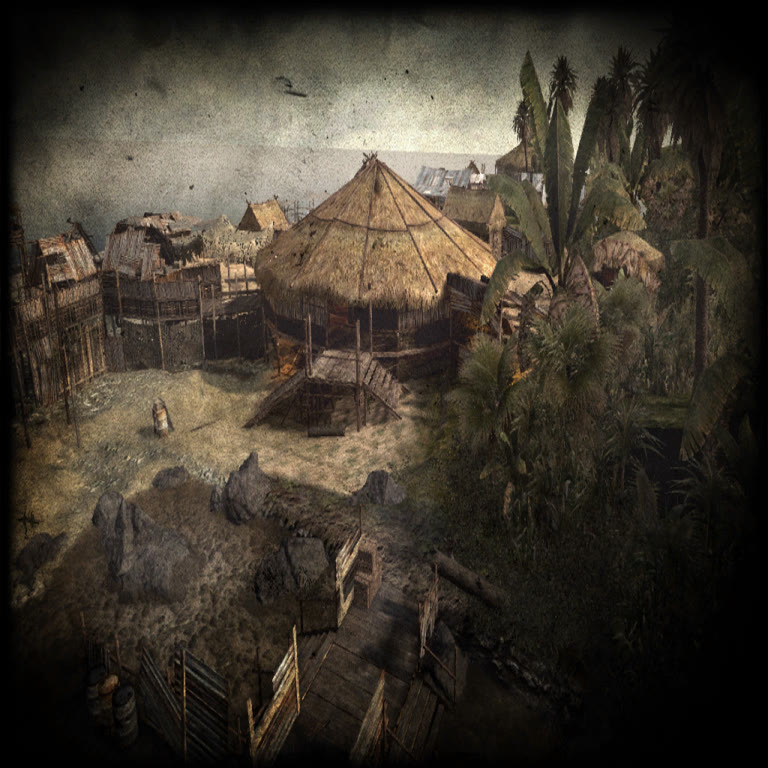
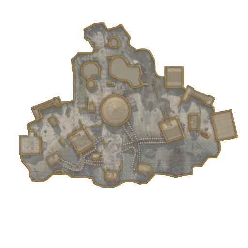
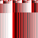

# The `.iwi` format — Call of Duty: World at War (Treyarch, T4)

Notes produced by empirical reverse engineering over the **9,331 `.iwi`
textures** inside the 31 `.iwd` (ZIP) files of
`/home/davi/Plutonium/pluto_t4_full_game/main/`, cross-checked against the
open-source **DevIL** loader (`il_iwi.cpp`, which reads exactly 28 header bytes
and handles the format IDs below) and against a ModDB blurb ("IWI DDS Fast
Converter" → lists A8R8B8G8 / R8G8B8 / A4R4G4B4 / A8 / DXT1 / DXT3 / DXT5 /
3Dc).

The parser and converter live in [`iwitool.py`](iwitool.py); the native decoder
is `src/iwi.c` (`t4port iwi <file.iwi> -o out.png`).

> **Update — format names corrected later.** The table below originally used
> DevIL's names. Size-math validation over the full set (see
> [`../doc/RE_SUMMARY.md`](../doc/RE_SUMMARY.md)) corrected them:
> **ID 3 = A8L8** (not ARGB4444), **ID 12 = DXT5/BC3** (not DXT3/BC2),
> **ID 13 = DXN/BC5** normal map (not DXT5/BC3). The counts per ID are
> unchanged, and the samples below were decoded with the corrected IDs.

## Header (28 bytes, little-endian)

All 9,260 supported files violate none of the invariants below.

| Offset | Size | Field | Note |
|-------:|-----:|-------|------|
| `0x00` | 4 | magic | ASCII `"IWi"` + version byte. **Version `6` in 100% of the files.** |
| `0x04` | 1 | format | See the format table. |
| `0x05` | 1 | flags | See the flags section. |
| `0x06` | 2 | width | `u16` LE, > 0. |
| `0x08` | 2 | height | `u16` LE, > 0. |
| `0x0a` | 2 | depth | `u16` LE; **always `1`** in this sample (volume textures / `depth>1` never appeared). |
| `0x0c` | 4×4 | "lumps" `u32` | See semantics below. |
| `0x1c` | … | data | Payload (mipmaps). |

### Semantics of the `u32`s at `0x0c`

Let `fileSize` be the total file size and `N` the number of mipmap levels
actually written (1 in files without mips; the full chain otherwise):

- `lump[0] == fileSize` **always** (invariant 9260/9260).
- `lump[i]` (for `i = 0..3`) = `fileSize − Σ_{j < min(i, N−1)} size(level j)`

  where `size(level j)` is the byte size of level `j` **ordered from the
  smallest to the largest** (`j=0` = smallest). In other words, each lump tells
  how many bytes remain in the file if we skip the `i` biggest mips. In files
  with `N == 1` all four lumps equal `fileSize`.

  Observed corner case: `images/com_black.iwi` (4×4 DXT1, 3 levels) → lumps
  `(52, 44, 36, 36)`; `lump[3]` repeats `lump[2]` because of the
  `min(i, N−1)` clamp.

## Mipmap order

**Mips are written from SMALLEST to LARGEST**: the *top* level (highest
resolution) is the **last** data block of the file. Confirmed by:

- downsample consistency (the average/`mad` between a mip and its resampled
  level matches the "smallest-first" order — e.g. `mad≈1.4–3.0` versus
  `≈9.5–33.9` in the reversed order), for both DXT and raw formats
  (`sun_moon.iwi`: `A=52.90` / `B=0.27`);
- the DevIL loader explicitly states "smallest to the largest".

The offset of level 0 inside the body is `body_len − size(level 0)` for files
with mips, and `0` for files without mips.

## Flags (`0x05`)

| Mask | Meaning | Evidence |
|------|---------|----------|
| `(flags & 3) == 3` | **no mipmaps** (`nomips`) | 877 files (833 DXT + 44 raw), 0 exceptions. |
| `0x04` | **cubemap** | 20 files; payload = 6 mip chains. |
| `0x01`, `0x20`, `0x40`, `0x80` | **unknown** | DevIL marks them "@TODO". They appear combined (e.g. `0xc3`, `0xc0`, `0xc1`). |

## Format table

Counts over the 9,260 supported files + 71 unsupported = 9,331.

| ID | Name | Bytes/pixel (or/block) | Files | Status |
|---:|------|------------------------:|------:|--------|
| 1 | BGRA8888 | 4 B/px | 48 | supported |
| 2 | BGR888 | 3 B/px | 29 | supported |
| 3 | A8L8 (early guess: ARGB4444) | 2 B/px | 46 | supported |
| 4 | A8 | 1 B/px | 22 | supported |
| 6 | unknown | variable-size payload | 41 | **unsupported** (exit 2) |
| 7 | unknown | variable-size payload | 5 | **unsupported** (exit 2) |
| 8 | unknown | variable-size payload | 3 | **unsupported** (exit 2) |
| 9 | unknown | variable-size payload | 2 | **unsupported** (exit 2) |
| 11 | DXT1 / BC1 | 8 B per 4×4 block | 2,667 | supported |
| 12 | DXT5 / BC3 (early guess: DXT3/BC2) | 16 B per 4×4 block | 803 | supported |
| 13 | DXN / BC5 normal map (early guess: DXT5/BC3) | 16 B per 4×4 block | 5,665 | supported |

(20 of the 9,331 are cubemaps and are rejected separately, regardless of
format.)

### How each format was determined

- **ID 11 = DXT1**: `$black.iwi` is 36 bytes = 28 (header) + 8 = exactly one
  4×4 BC1 block.
- **ID 1 = BGRA8888**: `waypoint_x_red.iwi` has byte `b2` (=130) as the red
  channel → order B,G,R,A.
- **IDs 12 vs 13**: first identified by alpha-channel mip consistency; later
  corrected and confirmed by size math + content — ID 12 textures are diffuse
  maps that decode perfectly as DXT5/BC3, and ID 13 files carry the `_n`
  suffix with R mean ≈ 129.7 (a normal-map statistic), i.e. DXN/BC5.
- **IDs 2 and 4**: size arithmetic (3 and 1 B/px) + visual conversion.
- **ID 3**: the mip chain closes exactly (21,845 px = sum of 128²…1×1) and the
  decoded look is correct for A8L8 (luma in one byte, alpha in the other).

### Samples decoded by `t4port iwi`

| BC1/DXT1 — 1024×1024 load screen | BC3/DXT5 — 512×512 compass map |
|---|---|
|  |  |

| BC5 normal map — 256×256 | A8L8 (early read: ARGB4444) — 64×64 | BC3 cursor — 64×64 |
|---|---|---|
|  |  |  |

<i>Call of Duty: World at War</i> textures (© Activision/Treyarch),
decoded by this repository's tools — local documentation use only.

## Cubemaps (`flags & 0x04`)

20 files; the payload holds **6 mip chains** (one per face). The face order
**was not verified**, so `iwitool.py` rejects them with exit code 2 instead of
guessing.

## Uncertainties / limitations

- **Formats 6, 7, 8, 9**: variable-size payload, entropy ~5.4–7.9, no known
  magic (neither JPEG nor zlib). DevIL calls `0x07` "JPG", but the WaW payload
  does **not** behave like JPEG — treated as unsupported (exit 2).
- **Flags `0x01/0x20/0x40/0x80`**: semantics unknown.
- **`depth > 1` / 3D textures**: never appeared; behavior presumed, untested.
- **Cubemaps**: rejected (face order not determined).

## Validation

5 samples from 5 different `.iwd`s converted and validated (pure Python:
signature, IHDR, chunk CRC, `zlib.decompress` with the exact size
`h*(1+w*4)`, filter 0 per row; plus `file` and `identify`):

| Sample | `.iwd` | Format | Dimensions |
|--------|--------|--------|------------|
| `loadscreen_mp_makin_day.iwi` | `iw_21.iwd` | DXT1 | 1024×1024 |
| `compass_map_mp_makin_day.iwi` | `iw_21.iwd` | DXT5 (early note: DXT3) | 512×512 |
| `blood_spatter01_col.iwi` | `iw_01.iwd` | BC5/DXN (early note: DXT5) | 256×256 |
| `gradient.iwi` | `iw_03.iwd` | A8L8 (early note: ARGB4444) | 64×64 |
| `3_cursor3.iwi` | `iw_00.iwd` | DXT5 (early note: DXT3) | 64×64 |

In all of them the PNG dimensions match the header.
