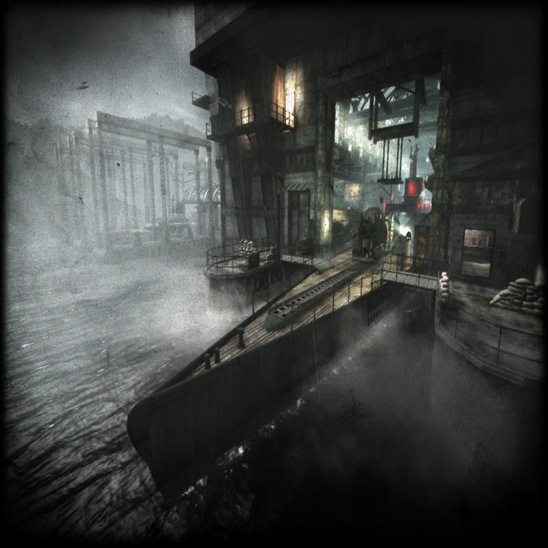

# T4Port platforms

The port core is **a single C11 codebase** in `src/` — there is deliberately
no per-OS copy of the source: duplicating the `.ff` parser four times would
guarantee the copies drift apart (that is how bugs are born). What changes per
OS is the **platform layer**, and each OS has its own folder here:

| Folder | Target | Build | Status |
|---|---|---|---|
| `linux/`   | `.sh` + Flatpak (x86_64) | `./build.sh` | ✅ **tested on this machine** |
| `macos/`   | `.app` (Intel/Apple Silicon) | `./build.sh` | ⬜ script ready; **needs a Mac** |
| `windows/` | `t4port.exe` (PE32+ x86-64) | `./build.sh` | ✅ **compiled and tested under Wine** |
| `freebsd/` | native binary (x86_64) | `./build.sh` | ⬜ script ready; **needs a FreeBSD** |

What is OS-specific in the code (and where it lives):

- `src/platform.c` — executable path (`/proc/self/exe`,
  `_NSGetExecutablePath`, `sysctl(KERN_PROC_PATHNAME)`, `GetModuleFileNameA`).
- `src/net.c` — Winsock2 (`_WIN32`) vs POSIX (`Linux/macOS/FreeBSD`).
- `src/sdl2_dyn.c` — `LoadLibrary` on Windows, `dlopen` elsewhere.
- `src/main.c` — `fork/exec` (POSIX) vs `_spawnvp` (Windows).
- `src/mods.c` — `mkdir(p,0755)` vs `_mkdir(p)`.

Wherever there is `#if defined(_WIN32)` / `__APPLE__`, the rest is pure POSIX —
which is why FreeBSD needs no code changes beyond `platform.c`.

  
   
  <i>Call of Duty: World at War</i> — multiplayer load screen
  (© Activision/Treyarch), decoded from an <code>.iwd</code> with this port's
  own tools; local documentation use only.

